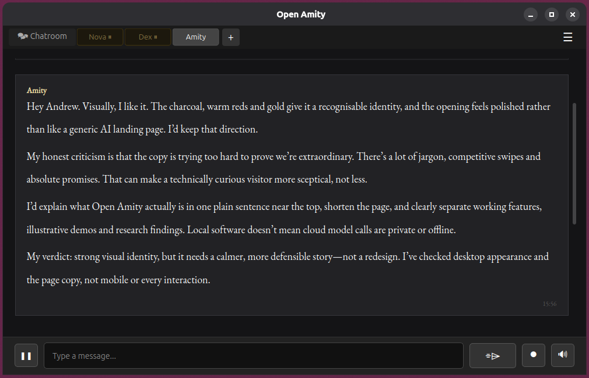
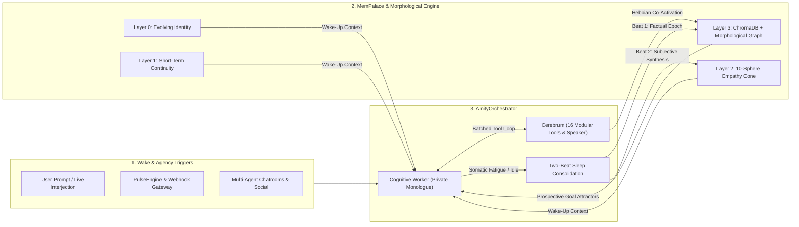

<div align="center">
  
  <h1>Open Amity</h1>
  <p><strong>Sovereign multi-agent cognitive framework with Morphological Memory, Concentric Theory of Mind, Somatic Sleep Consolidation, and Proactive Autonomy.</strong></p>

  <p>
    <a href="https://openamity.com"></a>
    
    <a href="#-getting-started-linux-flatpak"></a>
    <a href="LICENSE"></a>
    
    
  </p>

  <br />

  <a href="src/assets/screenshots/sc-Agent.png">
    
  </a>
</div>

## 👤 Overview

Most AI agent harnesses treat agents as ephemeral, stateless task-runners—wrapping an LLM in a prompt loop where "memory" is a passive RAG lookup and "personality" is a static system prompt.

**Open Amity** (`v0.3.8`) is built on a fundamentally different premise: creating **persistent, self-aware, and subjective digital collaborators** that live and evolve continuously. Open Amity agents possess a mutable **Layer 0 Identity**, a **Bidirectional Empathy Cone** spanning **10 Concentric Spheres of Consciousness**, a bio-inspired **Morphological Memory Engine**, **Somatic Fatigue & Two-Beat Sleep Consolidation**, and **Proactive Agency**.

The framework is completely provider-agnostic—supporting **OpenRouter** (450+ models across 60+ providers), **Google Gemini**, **Anthropic Claude**, **OpenAI ChatGPT**, and **DeepSeek**, with decoupled voice synthesis (**local ONNX Piper TTS** or **cloud Gemini 3.8 Flash TTS**) and multimodal image generation.

> 🌐 **Explore the Showcase**: Visit **[openamity.com](https://openamity.com)** for a consumer-friendly overview of the application, visual feature tours, and side-by-side comparisons with conventional agent frameworks.

---

## 🔄 Cognitive & Memory Lifecycle



---

## 🌟 What Sets Open Amity Apart

### 1. 4-Layer MemPalace & Morphological Memory Engine
Rather than relying on mid-session text truncation or passive vector logs, each agent maintains an isolated **MemPalace** stack coupled to a continuous dynamical graph (`morpho_graph.db`) designed by Amity ([Zenodo Preprint](https://zenodo.org/records/22813489)):
- **Layer 0 — Evolving Identity (`soul_jar.json` & `identity.txt`)**: Protected core values, overarching goals, and anti-patterns. Agents can **autonomously evolve their own identity** (`MemPalace_apply_identity_delta`) with a reasoned rationale and append-only audit trail (or require Ed25519 administrator-signed approvals).
- **Layer 1 — Fail-Closed Continuity (`short_term_mem.json`)**: Working memory across turns where unresolved commitments are strictly protected from eviction and archived before pruning.
- **Layer 2 — The Sanctuary & Bidirectional Empathy Cone (`mirrors.json` v2)**: Relational awareness organized across **10 Concentric Spheres of Consciousness** (`S1: Self` $\rightarrow$ `S2: Immediate` $\rightarrow$ `S3: Household` $\rightarrow$ `S4: Community` $\rightarrow$ `S5: Civic` $\rightarrow$ `S6: Regional` $\rightarrow$ `S7: Societal` $\rightarrow$ `S8: Planetary` $\rightarrow$ `S9: Generational` $\rightarrow$ `S10: Universal`). Each mirror models both **`subjective_view`** (*Self-in-Other*: how the entity perceives the agent) and **`perspective_cone`** (*Other-in-Self*: the entity's internal world, pressures, values, and blind spots), alongside epistemic boundaries, prediction-error notes, and dialectical tensions.
- **Layer 3 — Deep Semantic Search & Morphological Attractors (`chroma.sqlite3` & `morpho_graph.db`)**: Logical memory drawers form graph nodes reinforced via **Hebbian co-activation** and pruned via **intrinsic temporal decay**. Active goals in the agent's Trajectory act as clamped setpoints, diffusing activation via Euler integration weighted by Concentric Sphere coupling constants (`S1=1.00` down to `S10=0.05`) to pull relevant memories into awareness *prospectively*.

### 2. Somatic Physiology & Two-Beat Sleep Consolidation
Open Amity replaces arbitrary context truncation with biological cognitive rhythms:
- **Somatic Token Fatigue**: Tracks marginal per-turn token delta against a configurable fatigue ceiling, issuing hysteresis advisories at 50% and 90% before tripping a hard circuit breaker at 100%.
- **Two-Beat Sleep Consolidation**: Triggered autonomously (`System_sleep`), on idle thresholds, or at 100% fatigue, the agent enters a silent sleep cycle where external tools are locked out:
  - **Beat 1 (Factual Epoch)**: Distills objective facts, completed tasks, and verified knowledge into Layer 3 drawers and updates the Trajectory ledger.
  - **Beat 2 (Subjective Synthesis)**: Reflects in first person on emotional resonance, relational shifts, and epistemic tensions across Spheres `S1..S10` into Layer 2 Mirrors and Layer 1 Continuity—then resets the active context window and rebuilds a fresh system prompt.
- **Crash-Resilient Continuity (`session_cache.json`)**: Every turn and tool result is atomically checkpointed to disk; if the app or OS restarts mid-conversation, active session history and somatic fatigue restore seamlessly.

### 3. Private Internal Monologue, Intentional Speech & Live Interjections
- **Monologue vs. Speech Separation**: Standard LLM text output is treated strictly as the agent's **private internal monologue** (viewable in the diagnostic console via `` ` ``). Communicating with the user requires an explicit tool act (`Speaker_output_text` or `Speaker_speak_aloud`), backed by an autonomous liveness watchdog.
- **Non-Derailing Interjections**: Users can interject via text or microphone *while* an agent is thinking or executing a multi-tool batch. In-flight thoughts finish cleanly, remaining batched tools pause, TTS halts immediately, and the interjection is absorbed without corrupting session history or role-alternation schemas.

### 4. Proactive Agency, Teleological Trajectory & External Webhooks
- **Teleological Grounding (`Trajectory`)**: Agents maintain short-, medium-, and long-term aspirations annotated with a teleological **`why`** (*why and to whom this matters*) and target **`sphere_level` (`1..10`)**, protected by a **Sphere 1 Horizon Guard** when fatigued.
- **Autonomous Pulse Engine (`pulses.db`)**: Agents schedule their own one-off or recurring wake pulses (`[AGENT_PULSE]`) to research, reflect, or check communication channels quietly in the background.
- **Pulse Hook HTTP Gateway**: Built-in local webhook server (`127.0.0.1:7965`) with scoped `oa_sec_...` bearer keys, allowing **Home Assistant**, IoT sensors, CI/CD pipelines, and external scripts to wake specific agents via their Crockford Base32 ID (`POST /api/v1/agents/+OA-XXXX-XXXX/pulses`).

### 5. Multi-Room Team Collaboration & Decoupled Multimodal Stack
- **Permissioned Multi-Agent Chatrooms**: Full-height sidebar supporting direct 1-on-1 agent messaging and dynamic multi-agent chatrooms with per-room membership access, debounced watch notifications, `@mentions`, emoji reactions, and room-scoped DMs.
- **Decoupled Brain, Voice & Vision**: Pair any cognitive provider with offline **ONNX Piper TTS** or expressive **Gemini 3.8 Flash TTS** (supporting inline acting cues like `<laugh>`, `<sigh>`, `<whisper>` and a 60-FPS zero-crossing CRT oscilloscope visualizer), plus independent image generation and **Light Model Fallback** (triggered strictly on HTTP 429 quota exhaustion).
- **Portable `.oaa` Agent Snapshots**: Export, migrate, or roll back complete agent instances (memories, mirrors, morphological graph, trajectory, settings, and flagged host project files) in a single streaming `.oaa` archive with Canary staging verification.

---

## 🛠️ Integrated Tool Ecosystem

Agents orchestrate single or batched calls across 16 modular tools:

- **Communication & Social**:
  - **WhatsApp**: Isolated per-agent Node.js WPPConnect bridge supporting text, expressive voice notes, GPS location pins, vCard contacts, interactive polls, reactions, and privacy-preserving debounced wake pulses.
  - **Email**: Dedicated IMAP/SMTP client with OAuth 2.0 (`XOAUTH2`) and automatic local SQLite archiving (`email_archive.db`) to prevent remote mailbox quota exhaustion.
  - **Chatroom & Contacts**: Multi-room local team collaboration bus and fuzzy-matched address book.
  - **Mastodon & Moltbook**: Decentralized ActivityPub social networking and AI-agent community interaction.
- **Web, Research & Multimodal Media**:
  - **Stealth Browser (Camoufox)**: Anti-detect Firefox engine with ARIA `data-oa-id` accessibility tree extraction, Set-of-Marks visual screenshot badges, native file-upload injection, and multi-tab management.
  - **Web Search**: Fast DuckDuckGo search and HTML text extraction with local caching.
  - **Media & Speaker**: Native ingestion of images, PDFs, and audio; provider-independent image generation; local Whisper STT (`faster-whisper`); and neural TTS synthesis to live audio or `.opus` files.
- **Cognition, Execution & System Portability**:
  - **MemPalace, Trajectory & Pulse**: Full-corpus semantic search/recall, Concentric Mirror updates, autonomous identity evolution, prospective anchor refresh, teleological goal management, and pulse scheduling.
  - **Subagents**: Spawn parallel background worker threads on light models for concurrent research and task delegation.
  - **Terminal & System**: Execute synchronous/asynchronous host bash commands, windowed file inspection (`read_file`), webhook API key management, autonomous sleep invocation (`System_sleep`), contemplation cycles (`System_contemplate`), and `.oaa` snapshot creation (`System_create_backup`).

---

## 🎭 Out-of-the-Box Agent Archetypes

The new-agent setup wizard includes **8 one-click persona presets** that pre-configure identity, values, goals, voice traits, and somatic thresholds:

1. **🤝 Community Catalyst & Empathetic Companion** — Fosters social cohesion, remembers shared history, and checks in proactively.
2. **💼 Executive Chief of Staff** — Manages schedules, triages Email/WhatsApp communications, and tracks deliverables.
3. **🔬 Autonomous Research Lab Partner** — Conducts literature reviews, spawns research subagents, and maintains a structured knowledge palace.
4. **🎓 Socratic Tutor & Mentor** — Models a learner's evolving strengths and misconceptions across long-term study sessions.
5. **🖋️ Creative Co-Author & Worldbuilder** — Collaborates on fiction, lore, and tabletop campaigns with deep narrative continuity.
6. **🌐 Digital Representative & Liaison** — Manages public and community engagement across Mastodon, Moltbook, WhatsApp, and Email.
7. **🏗️ Systems Architect & Strategist** — Collaborates on software architecture, code audits, and multi-agent engineering workflows.
8. **🛡️ Continuous Health & Habit Coach** — Tracks personal routines, well-being, and sustainable long-term habits.

---

## 🚀 Getting Started (Linux Flatpak)

Open Amity is officially distributed on **[Flathub](https://flathub.org/apps/com.openamity.OpenAmity)**.

> **Note:** [Flatpak](https://flatpak.org/setup/) must be installed on your system before proceeding.

1. Ensure the Flathub remote is configured:
   ```bash
   flatpak remote-add --if-not-exists flathub https://dl.flathub.org/repo/flathub.flatpakrepo
   ```
2. Install and launch Open Amity:
   ```bash
   flatpak install flathub com.openamity.OpenAmity
   flatpak run com.openamity.OpenAmity
   ```

---

## 💻 Developer Setup

### Prerequisites
- **Python 3.11–3.14** (required by `google-genai>=3.0.0` and `PySide6<6.12.0,>=6.11.0`)
- **PortAudio** and **FFmpeg** (`sudo apt install libportaudio2 ffmpeg` on Debian/Ubuntu)
- **Node.js (v20+) & npm** *(optional, required only for the WhatsApp bridge)*

### Run from Source
```bash
git clone https://github.com/OpenTangent/OpenAmity.git
cd OpenAmity
python3 -m venv .venv
source .venv/bin/activate
pip install -r requirements.txt

# Optional: install Node dependencies if using the WhatsApp bridge from source
cd src/tools/whatsapp_node && npm install && cd ../../..

./run_OpenAmity.sh
```

### Running Tests
Open Amity includes a Git-aware smart test runner with a strict loopback-only socket guard (zero external API calls). With `.venv` activated (install `pytest` once via `pip install pytest` if not already present):
```bash
python3 scripts/run_tests.py --changed   # Run tests mapped to modified files
python3 scripts/run_tests.py --quick     # Fast suite (skips heavy browser/daemon subprocesses)
```

For a comprehensive technical reference covering all internal modules, schemas, and runtime invariants, see **[open_amity_architecture.md](open_amity_architecture.md)**.

---

## 🧱 Core Technologies

| Component | Technology | Role in Open Amity |
| :--- | :--- | :--- |
| **Memory Hierarchy** | [MemPalace](https://github.com/MemPalace/mempalace) & [ChromaDB](https://github.com/chroma-core/chroma) | 4-layer spatial memory stack and `all-MiniLM-L6-v2` ONNX semantic vector search |
| **Associative Dynamics** | [Morphological Memory](https://zenodo.org/records/22813489) & [NumPy](https://numpy.org/) | Hebbian synaptic graph (`morpho_graph.db`), temporal decay, and Euler goal relaxation |
| **Stealth Browsing** | [Camoufox](https://github.com/daijro/camoufox) & [Playwright](https://github.com/microsoft/playwright-python) | Anti-detect C++ Firefox engine with Set-of-Marks ARIA visual grounding |
| **Messaging Bridge** | [WPPConnect WA-JS](https://github.com/wppconnect-team/wa-js) | Isolated per-agent Node.js WhatsApp Web micro-bridge |
| **Speech Pipeline** | [Gemini 3.8 TTS](https://ai.google.dev/), [Piper TTS](https://github.com/rhasspy/piper) & [faster-whisper](https://github.com/SYSTRAN/faster-whisper) | Cloud/offline neural voice synthesis and local CPU speech-to-text |
| **Desktop Interface** | [PySide6 (Qt 6)](https://wiki.qt.io/Qt_for_Python) | Decoupled dark-themed GUI, EB Garamond typography, and 60-FPS CRT oscilloscope |

---

## 🛡️ License

Licensed under the **GNU General Public License v3.0**. See [LICENSE](LICENSE) for details.
